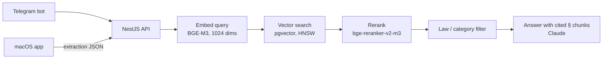

<h1 align="center">rag-system</h1>

<p align="center">
  Retrieval-augmented answers about German law, from a Telegram bot<br>
  and an on-device macOS companion app.
</p>

<p align="center">
  <a href="LICENSE"></a>
  
  
  
  
</p>

> [!IMPORTANT]
> This is a research and engineering project, **not legal advice** and not a
> legal service. Answers are generated by an AI model and can be incomplete,
> outdated or wrong. For anything that matters, consult a qualified lawyer or
> an official advice centre. See the [Disclaimer](#disclaimer).

## What it does

Ask a question in Russian or German. The system finds the relevant statute
text and answers with cited sources at `§` level. Your own documents can be
added as context.

- **Statute search** over German federal law stored in PostgreSQL + pgvector.
- **Two front ends:** a Telegram bot (grammY) and an HTTP API (`/app/v1/*`)
  used by the macOS app.
- **Privacy-oriented desktop app:** the macOS app extracts details
  (deadlines, amounts, contacts) from documents on the device and is designed
  so that raw document text stays there and only extraction JSON syncs. This
  is a design goal, not an audited guarantee.
- **Measured, not assumed:** two eval harnesses guard retrieval and
  extraction quality (see [Evaluation](#evaluation)).

## How it works



| Layer | Technology |
|---|---|
| Backend | NestJS 10, TypeScript (strict), Prisma |
| Storage | PostgreSQL 16 + pgvector, Redis (BullMQ) |
| Bot | grammY |
| Retrieval models (served locally) | BGE-M3 embeddings, `bge-reranker-v2-m3`, in `services/retrieval-models/` |
| LLMs | Anthropic Claude: Sonnet for answers, Haiku for classification |
| macOS app | Rust Cargo workspace in `apps/macos/` (`dokumente-core` + Tauri shell) |

## Law corpus

The statute texts are **not** part of this repository. The ingestion service
fetches them from [gesetze-im-internet.de](https://www.gesetze-im-internet.de/),
published by the German Federal Ministry of Justice. Check that site's terms
before redistributing any corpus you build.

## Getting started

You need Node.js, Docker Compose and an Anthropic API key. The macOS app
also needs a Rust toolchain.

```sh
cp .env.example .env              # fill in the values
docker compose up -d postgres redis retrieval-models
npm ci
npx prisma migrate deploy
npm run start:dev
```

`docker-compose.yml` also defines an `app` service. Images are built locally
(`docker compose build`); set `APP_IMAGE` and `RETRIEVAL_MODELS_IMAGE` to use
prebuilt images instead.

Law ingestion and the BGE index backfill are described in
[`eval/README.md`](eval/README.md#bge-index-preparation).

| Command | Purpose |
|---|---|
| `npm test` | Jest unit tests |
| `npm run lint` | ESLint |
| `npm run build` | Compile to `dist/` |

The PDF letter generator signs with the `PDF_SIGNATURE_NAME` environment
variable (default `—`).

## Evaluation

### Retrieval

44 hand-written questions (22 ru / 22 de) run through the production
retrieval path against the seeded corpus. Setup, including the required BGE
index, is in [`eval/README.md`](eval/README.md).

```sh
npm run eval:retrieval
```

| n | recall@5 | recall@10 | MRR |
|---|---|---|---|
| 44 | **0.568** | 0.682 | **0.412** |

### Extraction (macOS app)

Synthetic German documents carrying 68 planted details, no real user data.
Tier 1 (the deterministic backstop) is a CI gate. Tier 2 runs the real local
model N times per fixture and diffs against `eval/extraction/baseline.json`,
which finds all 68 details in 5 of 5 runs.

```sh
npm run eval:extraction          # tier 1, no model needed
npm run eval:extraction:model    # tier 2, needs a ~4.8 GB GGUF model
```

Details: [`eval/extraction/README.md`](eval/extraction/README.md).

The numbers above come from this project's own small test sets and do not
promise accuracy on real questions or documents.

## Disclaimer

- **No legal advice.** Nothing here, in the code, the documentation or any
  output of a deployed instance, is legal advice or a legal service
  (*Rechtsdienstleistung*, RDG). No lawyer-client relationship is created.
- **No warranty.** The software is provided "as is", without warranty of any
  kind and without liability, as set out in sections 7 and 8 of the
  [Apache License 2.0](LICENSE). Law changes; the corpus can be stale or
  incomplete, and a language model can misstate or invent content.
- **Use at your own risk.** You run this software, and use any resulting
  outputs, entirely at your own risk. The author is not liable for damages,
  losses or legal consequences arising from its use, to the extent permitted
  by applicable law.
- **Operator responsibility.** If you run an instance, you are responsible
  for it: data protection (GDPR/DSGVO, including consent, retention and
  deletion for user data), the terms of Anthropic, Telegram and any other
  service you connect, and whether offering legal information to the public
  is permitted where you operate.
- **No hosted service.** The author does not operate a public instance of
  this software and does not offer any service, legal or otherwise, to end
  users. The code is published for study and reuse only.
- **Third-party content.** Statute texts come from
  [gesetze-im-internet.de](https://www.gesetze-im-internet.de/) and model
  weights from their publishers. Their licences and terms apply and are not
  changed by this project's licence.
- **Fictional test data.** All people, companies, addresses, phone numbers,
  IBANs and documents in test fixtures and the golden set are invented. Any
  resemblance to real persons or organisations is coincidental.
- **Not affiliated** with the German Federal Ministry of Justice, Anthropic,
  Telegram, BAAI or any other third party named here.

## Contributing and security

- [CONTRIBUTING.md](CONTRIBUTING.md) for code rules, tests and PR format.
- [SECURITY.md](SECURITY.md) for reporting vulnerabilities privately.

## License

Apache License 2.0. See [`LICENSE`](LICENSE).
